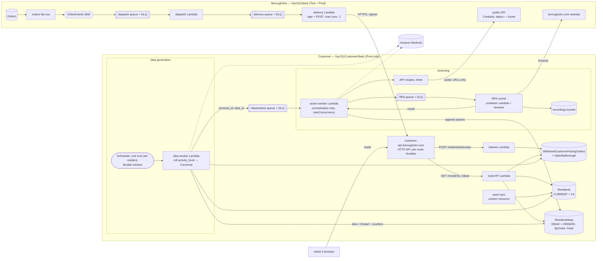

# The Customer — Simulated Support-Seekers + BoroughSim Lifecycle Webhooks

> **Status (2026-10-17): residents and idea generation built (Appendix O);
> the BoroughSim webhook and the customer listener are live in Prod since
> 2026-10-14.** BoroughSim
> delivers `ORDER_ACCEPTED` and `ORDER_RESOLVED` to the customer's
> listener, which records the orders in play in
> `WebhookCustomerFacingOrders-Prod` (Appendices H, I and J). Personas,
> ideas, the read API and the UI are not started. Everything below this
> line is the 2026-10-05 capture as amended by the 2026-10-10 and
> 2026-10-13 reviews.
>
> **Original status (2026-10-05): capture draft — nothing built, nothing final.**
> Spec for [#58](https://github.com/seththeeke/nyc-311/issues/58), reshaped
> in-session. This version is a **capture of intent**, restructured into six
> sections that will each be worked through one at a time, with deliberate
> thought, in later sessions. No build starts until all six are reviewed.
>
> How to read it: each section has **Captured so far** (what has been said or
> proposed) and **To go deep on** (the questions that section's review must
> answer). "Captured" is not "agreed" unless the Decision Log in the Appendix
> says so. `customer/` stays locked until `CLAUDE.md` gains the sections
> proposed in Appendix F (§1.1 Directory Lock).

| # | Section | Review status |
|---|---|---|
| 1 | [Problem Statement](#1-problem-statement) | Considered sufficient |
| 2 | [Data Model](#2-data-model) | BoroughSim side (`WebhookSubscription`) agreed 2026-10-10 and **built**; customer side not reviewed |
| 3 | [Interaction Model](#3-interaction-model) | Not reviewed |
| 4 | [UX Design](#4-ux-design) | Not reviewed |
| 5 | [BoroughSim Webhook Design](#5-boroughsim-webhook-design) | Design decisions (items 5–15) agreed 2026-10-10 and **built 2026-10-11** (Appendix H); foundations (items 1–4) not walked through |
| 6 | [Isolation](#6-isolation) | Enforcement for the listener milestone agreed 2026-10-13 and **built** (Appendix J); the full review (items 1–10) not done |

---

## 1. Problem Statement

BoroughSim models only the supply side today: ingestion → orders → crews.
Real field-service businesses live or die on customer interaction, and
nothing in the system currently *wants* anything from it.

**The Customer** is an autonomous, simulated demand side: a small roster of
LLM-driven personas that behave like real New Yorkers following their 311
complaints. Each persona has a personality, a custom prompt and an activity
level, and on a believable, irregular cadence it has an **Idea** — *"I need
something"* — about an order BoroughSim has accepted, or about the service
itself ("I wish it would text me when the crew is on the way").

Phase 1 produces and logs Ideas, and makes the customers and their ideas
visible. Nothing acts on an idea yet. Later, a persona *actions* an idea
through some channel — a phone call, a text, driving the website, an MCP
server — and **that pressure is what drives which support capabilities the
BoroughSim has to grow**. The customer is the source of product ideas; BoroughSim
evolves to meet them.

Constraints that shape everything below:

- **A real outsider.** The customer exists once, against **Prod only**, and
  reaches BoroughSim only the way a real user could. Changes to BoroughSim
  are tested in Test; the customer is where the ideas for them come from.
- **Pure isolation.** Own backend package, own infrastructure directory,
  own data. Enforced by lint and tests, not by convention (§6).
- **Pluggable.** Anchor source, idea planning, idea generation, recruiting
  and the Idea → action hand-off are separate components.
- **Phase 1 scope:** 1–3 personas; the BoroughSim webhook; idea generation and
  storage; a public read API and a feature-flagged UI. No actioning, no
  answering, no conversations.

---

## 2. Data Model

### Captured so far

**Entities**

| Entity | Owner | Purpose |
|---|---|---|
| `WebhookSubscription` | BoroughSim | Who gets which events, at what URL, signed with what secret |
| Customer / Persona | Customer | The roster: identity, backstory, prompt, dials |
| `AcceptedOrder` | Customer | The customer's own copy of public metadata for orders BoroughSim accepted |
| `Idea` | Customer | One "I need something", logged `OPEN` |

Proposed persona shape — a **resident** in the UI (roster and draft
prompts in Appendix B). Revised 2026-10-15 from the Residents page mock:
every attribute the mock shows is to be modelled; `status` is dropped;
`tagline`, a profile image and the idea counters are added.

```ts
type Persona = {
  persona_id: string;           /* the codename, lowercased */
  version: number;              /* bump on any edit; stamped on every idea */
  name: string;
  tagline: string;              /* one line on who they are, for the resident list */
  backstory: string;
  persona_prompt: string;
  model_key: string | null;     /* names the resident's bundled Three.js model (decision 3); null falls back to the initial */
  demeanor: { patience: number; hostility: number; verbosity: number };  /* 0-100 */
  activity_level: number;       /* 0-100, chance a scheduled firing becomes an idea (§3 Flow B decision 6) */
  model_id: string;             /* Bedrock model for this resident (§3 Flow B decision 2) */
  schedule: string;             /* EventBridge cron for this resident (§3 Flow B decision 6) */
  active_hours: { start: number; end: number };   /* America/New_York; start > end runs across midnight */
  follow_up_propensity: number; /* 0-100, return to a known order vs. a new one */
  idea_type_weights: Record<IdeaType, number>;
  action_buckets: ActionBucket[];               /* tools granted so far (decision 7); [] in P0 */
  action_weights: Record<ActionType, number>;   /* preference among granted tools */
  interests: { boroughs: string[]; descriptors: string[] };  /* order `descriptor` values; every complaint_type is "Street Condition" */
  idea_count: number;           /* maintained on write (A11), never counted on read */
  last_idea_at: string | null;  /* maintained on write (A11) */
};
```

**Profile images (design requirement, 2026-10-15; decided 2026-10-17).**
Every resident gets a picture: a snapshot of their own hand-authored
Three.js model, bundled into the web-app (customer side, decision 3). Not
built yet; the mock shows the resident's initial in a neutral circle, which
stays as the fallback.

**No status.** Residents are not shown as active or paused. If the
simulation needs a way to stop one resident having ideas, that is an
operational switch for the §3 review, not a modelled attribute.

Idea fields so far: `idea_id`, `persona_id`, `persona_version`, `idea_type`
(`STATUS_CHECK`, `SERVICED_CHECK`, `ETA_REQUEST`, `PRIORITY_INQUIRY`,
`ESCALATION`, `FEATURE_REQUEST`), `text`, optional anchor (`order_id`,
`external_unique_key`), `status` (`OPEN` only in phase 1), `created_at`,
`model_id`, `prompt_version`, token counts.

**Access patterns identified so far**

| # | Pattern | Caller | First thought |
|---|---|---|---|
| A1 | List customers (paginated) | UI list page | Roster is tiny now; must not rely on that |
| A2 | Get one customer | UI detail page, idea worker | Key lookup |
| A3 | List a customer's ideas, newest first, paginated | UI detail page | Make `persona_id` + time the **table key**, not a GSI |
| A4 | Get one idea | UI, future actioner | Needs a design if A3 owns the key |
| A5 | A customer's prior ideas about one order | Planner, generator | Sort-key or secondary index design |
| A6 | Orders a customer has already had ideas about | Planner (follow-up choice) | Derived from A5, or its own item |
| A7 | Pick a *fresh* accepted order weighted by interests | Planner | **Hardest one** — a random pick must not be a table scan |
| A8 | `OPEN` ideas, oldest first | Future actioner | Sparse index |
| A9 | Upsert an accepted order idempotently | Webhook listener | Conditional put on the event id |
| A10 | Active subscriptions for an event type | BoroughSim dispatcher | Tiny today |
| A11 | Per-customer idea count / last-idea time | UI list page | Counter maintained on write, never counted on read |

### Agreed — BoroughSim side: `WebhookSubscription` (2026-10-10)

Reviewed question by question; resolves "To go deep on" item 9 below. The
customer is realistically the only subscriber, so every choice leans
minimal and is additive later.

| # | Question | Decision |
|---|---|---|
| 1 | What one row represents | One row per endpoint: one `callback_url`, one secret, one status, an explicit `event_types` list. No wildcard. |
| 2 | Key design and A10 | Table `WebhookSubscriptions-{Test,Prod}`, PK `subscription_id` (ULID), no sort key, no GSI, plain `Dao`. The dispatcher does a Scan and filters in code; a hard cap on subscription count, enforced at create, keeps the scan bounded (same precedent as `FeatureFlagDao.listFlags`). Create returns the existing subscription when the `callback_url` is already registered. |
| 3 | Status lifecycle | `ACTIVE` / `PAUSED`, both manual. Hard delete. The system never disables a subscription itself; a failing endpoint retries, dead-letters and alarms. |
| 4 | Signing secret | SSM Parameter Store SecureString; the row stores only `secret_parameter_name`. The subscriber supplies the secret at registration, so re-registration is idempotent and doubles as rotation. The registration controller redacts the secret from its request/response logging. |
| 5 | Ownership | A required `name` label only. No owner entity, and no `created_by`: registration uses one shared API key, so there is no distinct caller to record. |
| 6 | Mutability | `subscription_id`, `created_at`, `callback_url`, `secret_parameter_name` immutable. Re-registration overwrites `name`, `event_types` and the secret value, and never touches `status`. Writes are a full put conditioned on `version`. |
| 7 | Delivery attempts | Not an entity. One structured log line per attempt, plus the DLQ and SQS redrive. Revisit with §5 item 11. |

Stored row:

```json
{
  "subscription_id": "01K74Q8ZJ6M3T9X2R5VYB1C0DE",
  "name": "the-customer",
  "callback_url": "https://customer-api.boroughsim.com/webhooks/bureau",
  "event_types": ["ORDER_ACCEPTED", "ORDER_RESOLVED"],
  "status": "ACTIVE",
  "secret_parameter_name": "/nyc311/prod/webhook/01K74Q8ZJ6M3T9X2R5VYB1C0DE/secret",
  "version": 1,
  "created_at": "2026-10-10T14:03:11.000Z",
  "updated_at": "2026-10-10T14:03:11.000Z"
}
```

Still open from this review: the callback host is illustrative (§4 item
11).

### Agreed — customer side (review started 2026-10-17)

Reviewed question by question, the same way as the BoroughSim side above.

| # | Question | Decision |
|---|---|---|
| 1 | Customer vs. Persona: one entity or two | One entity, the resident, with **its version history kept in the same table**. Partition key `persona_id`. Sort key `CURRENT` is the live row; `V#0001`, `V#0002`, ... are frozen copies, one per version. A version row is written once, conditioned on `attribute_not_exists`, and never changed. An edit writes the new version row and updates `CURRENT` (conditioned on the old `version`) in one transaction. Counters (`idea_count`, `last_idea_at`) live only on `CURRENT`. An idea's `persona_version` resolves to its exact prompt and dials with one `GetItem`. Rejected: overwriting in place (old ideas lose their prompt) and separate Customer and Persona tables (too much structure for the roster's size) |
| 2 | Where residents come from | **Seed files in the repo are the source of truth**: one JSON file per resident in `customer/backend/residents/`, zod-validated in tests and at sync. A CloudFormation custom resource in the customer stack syncs them on deploy. The sync hashes each file's content and writes the next `V#` row when the hash changes, so version numbers are assigned by the sync, never typed in a file. Removing a seed file never deletes the resident (ideas still point at it); stopping a resident's ideas is the §3 operational switch. Rejected: hand edits in DynamoDB (unreviewed, easy to skip the version row) and an admin edit API (auth and writes on the customer side for three residents) |
| 3 | Profile images | **Each resident is a hand-authored Three.js model file in the repo**, written when the resident is created locally (e.g. `web-app/src/components/residents/models/sycamore.ts` exporting `buildSycamore(): Group`) and bundled into the frontend. No generated looks, no look spec, no runtime procedural generation, no image bucket. `avatar_image` becomes `model_key: string \| null` (e.g. `"sycamore"`); a web-app registry maps keys to model files, and a null or unknown key falls back to the initial. Model files are held to the linter and a written style guide: built only from the shared `threeKit` helpers (same flat-shaded low-poly look as the Mapv2 trucks and crew), colours from a fixed palette, a size cap, and a per-model test that it builds under a triangle budget. The avatar is a head-and-shoulders snapshot of the same model from one shared offscreen renderer, cached and shown as an ``; Three.js is lazy-loaded; no WebGL falls back to the initial. A model change is a frontend change, not resident data, so it creates no new `V#` |
| 4 | Ideas table keys | **Its own `Ideas` table** (residents stay one table per entity); the idea put and the resident's `CURRENT` counter update share one transaction. Partition key `persona_id`. Sort key `IDEA#<ulid>` serves A3 (query, newest first) and A4 (`GetItem`; the route carries both ids). A **thread row** per resident per order, sort key `ORDER#<order_id>` with `idea_count` and `last_idea_at`, written in the same transaction, serves A6 with one prefix query. Sparse index `ByOrder` (partition `persona_id#order_id`, sort ULID) on anchored ideas serves A5. Index `Feed` (partition `ALL`, sort ULID) serves the new A12, every resident's ideas newest first, for `GET /ideas`; a few writes an hour is far under one partition's limit, and it can be split by day later without an API change. A8 is deferred until an actioner exists. No TTL on ideas. Public routes are `/residents/...`, not `/customers/...` |
| 5 | A7: picking a fresh order | **Sparse random-key index on `WebhookCustomerFacingOrders-Prod`.** When an order opens, the listener also writes `open_borough` (the borough) and `pick_key` (a random value); when it closes, it removes both, so index `OpenByBorough` (partition `open_borough`, sort `pick_key`) holds only open orders. The planner picks a borough from the resident's `interests.boroughs`, draws a random value, reads the next 20 entries from it (wrapping to the start), drops orders that have an `ORDER#` thread row for that resident, prefers their `complaint_types`, and picks one. Nothing open in that borough: try the resident's next borough, then log a "no candidate" skip (§3 item 3). The listener knows nothing about residents. Supersedes "no index until the persona work" (2026-10-13). Rejected: newest-first sort (residents would only ever notice brand-new orders) and per-resident candidate lists filled by the listener (couples the listener to residents, fans out writes, needs backfills) |
| 6 | Does an idea keep a copy of its order | **No copy; order rows no longer expire.** The 2026-10-13 TTL on `WebhookCustomerFacingOrders-Prod` is rolled back: the listener stops writing `expires_at` and TTL is explicitly disabled on the table (rows written before 2026-10-17 still carry the attribute). An idea stores `order_id` (and `external_unique_key`); the read API builds the response's `anchor` from the order row, one `BatchGetItem` per page, so the mock's response shape is unchanged. Growth is a few hundred rows a day, small for a table that never shrinks. Rejected: an immutable copy on each idea, and reference-only with the order expiring ("order no longer tracked") |
| 7 | Resident actions | **Actions are tools, granted in buckets.** A bucket is a named set of action types; buckets are granted to residents incrementally as each capability is built (first `REQUEST_FEATURE`, once feature intake exists; then `CHECK_STATUS_API`; then `BROWSE_WEBSITE`). A resident carries `action_buckets` (the buckets granted) and `action_weights: Record<ActionType, number>` (their preference among granted tools, like `idea_type_weights`), both frozen into each `V#`. **Many actions per idea:** the resident works its idea like an MCP client — offered its granted tools, it chooses which to call, in what order and with what input, in its own words; the freedom is deliberate. Each call is one entry in `actions[]` (P0: `[]`). **A failed action is recorded `FAILED` and that is all** — no retry machinery. **Stored on the idea row** as an array of objects. Larger artifacts (RPA output and the like) will later move to their own store, e.g. a customer-side S3 bucket, referenced from the entry; until then the row holds everything, and a cap on entries and evidence size keeps it well under DynamoDB's 400 KB item limit. Still for §3: the per-idea step cap and cost cap, and how weights shape which tools are offered |
| 8 | Feature intake | **A BoroughSim website feature built on a new, generic `Contact` entity.** A contact is someone reaching BoroughSim; `contact_type` says what kind, and the first type is `FEATURE_REQUEST`. The web-app gets a feature request component that creates a contact of that type. A resident's `REQUEST_FEATURE` tool submits through the same public contact route the component uses, so a resident reaches BoroughSim the way a person would; the returned contact id is the evidence's `reference_id`. **Contact is the start of what was previously called Cases**: inbound contact is where the case concept now begins, rather than only system-raised Cases (`data-model.md` § Case). The Contact design itself (fields, statuses, the route and its abuse limits, the component, how it relates to the existing Case entity) is BoroughSim-side work for its own design pass, not this review. Rejected: a customer-side-only intake (records requests no one receives) and opening GitHub issues directly (could become a later triage step) |
| 9 | Pagination and naming | **Pagination**, every list route: an opaque base64url cursor over the DynamoDB position, returned as `{ items, nextCursor }`; `limit` defaults to 20, at most 50; on `/residents/{id}/ideas` a cursor from another resident is a `400`. Pages are ordered by ULID, so they stay stable while ideas arrive; new ideas show on refresh. **Naming:** "Idea" stays. New tables `Residents-Prod` (`CURRENT` and `V#` rows) and `ResidentIdeas-Prod` (`IDEA#` and `ORDER#` rows). **Code says "resident", infrastructure keeps "customer":** web-app and backend code use resident names (`residentService`, `ResidentPersona`, `ResidentIdea`, `components/residents/`, `VITE_RESIDENT_DATA_MODE`, `VITE_RESIDENT_API_BASE_URL`; renamed 2026-10-17), and new customer-side code (residents, ideas) is named for residents from the start. Existing customer infrastructure is not renamed: `Nyc311CustomerStack`, `cdk/customer/`, `customer/backend/`, `customer-api.boroughsim.com`, `WebhookCustomerFacingOrders-Prod` with its DAO/model, the Lambda environment variables and SSM paths. The `CUSTOMERS_TAB` flag keeps its name; it goes away once the page launches |

### To go deep on

1. ~~**Customer vs. Persona.**~~ Resolved 2026-10-17, decision 1 above.
2. **Key design per table**, written out as PK/SK/GSI with every access
   pattern above mapped to exactly one query — no scans, no filters on
   large result sets.
3. *(Resolved 2026-10-17, decision 5.)* **A7 at scale.** How to sample a random accepted order matching a
   persona's interests in bounded reads (bucketed partitions with a random
   sort key? a per-persona candidate list filled at webhook time?).
4. *(Resolved 2026-10-17, decision 6: orders no longer expire.)* **TTL vs. references.** Accepted orders expire; ideas don't. Does an idea
   carry a snapshot of its anchor so the UI still renders after expiry?
5. *(Resolved 2026-10-17, decision 9.)* **Pagination contract** for the public API: opaque cursors, page-size
   caps, and what "newest first" means under concurrent writes.
6. **Growth model.** Ideas per persona per day × personas × retention —
   what are the real numbers at 3, 10 and 100 personas, and where does the
   first thing break?
7. **Mutability.** Which fields are immutable once written (idea text?
   persona version?) and what is append-only.
8. **Reserved-for-later fields** (action, response, conversation) — reserve
   them now, or leave them out entirely until that phase designs them?
   *2026-10-15: `action` is now modelled from the start (nullable; see
   Appendix L). Response and conversation remain open.*
9. **BoroughSim side:** `WebhookSubscription` shape, where the signing secret
   lives, whether a delivery-attempt log is its own entity, and the
   `data-model.md` / `dao/` placement.
10. *(Resolved 2026-10-17, decision 9.)* **Naming.** Is "Idea" the right word (vs. Need, Intent)? Prod-only
    table names without an env suffix?

---

## 3. Interaction Model

### Captured so far

Three flows, end to end:

**Flow A — an accepted or resolved order reaches the customer**

```
[boroughsim] Orders table stream -> orders fan-out Lambda -> Nyc311OrderEvents SNS topic   (all exist)
[boroughsim] -> dispatch queue, filter {event_type: [ORDER_ACCEPTED, ORDER_RESOLVED]}   (3 attempts -> DLQ + alarm)
[boroughsim] -> dispatch Lambda: build the public payload (Order + its Request's own 311 record), one message per ACTIVE subscription
[boroughsim] -> delivery queue -> delivery Lambda (max concurrency 2): re-read subscription, sign, HTTPS POST
            failure -> retried every 30 min, 48 attempts (~1 day) -> DLQ + alarm
 ~~~~~~~~~~~~~~~~~~~~~~~ public internet ~~~~~~~~~~~~~~~~~~~~~~~
[customer] HTTP API -> receiveWebhookController: verify signature, dedupe, open or close the order
```

**Flow B — a resident has an idea** (revised 2026-10-17, see "Agreed — Flow B" below)

```
[customer] EventBridge Scheduler: one schedule per resident, its own cron  -> ideaWorkerController
             load the resident (CURRENT: prompt, model_id), check kill switch + caps
             roll activity_level: a miss is a logged skip
             gather context (code): a few sampled candidate orders (A7), the resident's
                                    open threads and recent ideas
             IdeaGenerator (Bedrock Converse, the resident's model_id): the model decides —
                                    what the idea is, about which order or none, what type,
                                    in the resident's voice — or that there is nothing to say
             write Idea (OPEN) + thread row + CURRENT counters, one transaction
[customer] -> (once tools are granted) IdeaActions queue -> actionWorkerController
             Converse with the granted tools; the model picks a tool + its inputs,
             the tool runs its fixed recipe (API or RPA), the result goes back;
             each invocation appended to actions[]; stops at per-tool / per-idea caps
```

**Flow C — someone looks at it**

```
browser -> customer-api.boroughsim.com -> read controllers -> customer tables
```

Points already settled or proposed:

- Hourly tick. The random offset uses a one-time EventBridge Scheduler
  schedule because SQS delay caps at 15 minutes.
- Planning is deterministic code; only the wording comes from the model.
- The idea is *what they want and why*, not a message for any channel.
- Cheapest Bedrock text model; every idea records model, prompt version and
  token counts so an upgrade can be judged on data.
- Global kill switch and daily caps, since this runs only in Prod.
- Pluggable components: `AnchorSource`, `IdeaPlanner`, `IdeaGenerator`,
  `Recruiter` (no-op), and the Ideas table as the hand-off to a future
  actioner.

### Agreed — Flow B (2026-10-17)

| # | Question | Decision |
|---|---|---|
| 1 | Who decides the idea | **The model.** Code gathers context (a few candidate orders sampled per decision 5, the resident's open threads and recent ideas, the idea types) and enforces the limits (kill switch, caps, which orders are eligible); the model decides what the idea is, which order it is about or none, its type, and its wording, so residents can bring creative ideas. `idea_type_weights` become guidance in the prompt, not a code-side roll. Supersedes "planning is deterministic code" |
| 2 | Which model | **Configured per resident**: `model_id` on the resident, in the seed and frozen into each `V#`. Every resident starts on the cheapest Bedrock text model, confirmed against the pricing page and the account's model access at build time; the first choice is a placeholder until then |
| 3 | Prompt assembly | **In the codebase, deployed by the seed sync custom resource** (decision 2 of §2). The full prompt for a resident is small enough to store on the resident entity, so the `V#` row holds exactly what was sent, and the content hash covers it. Each idea's `persona_version` therefore identifies its prompt |
| 4 | Output handling | **Flexible.** No tight limits on what an idea may say; only basic sanity (non-empty, a generous length cap). The model has an explicit **"nothing to say"** outcome, logged and counted as a skip, not an error |
| 5 | The action loop | **Async, in its own bundle of logic**: after an idea is written, the idea worker enqueues `{ persona_id, idea_id }` on an `IdeaActions` queue (with a DLQ) and a separate action worker runs the loop. One Converse conversation: the resident's prompt, their idea, and their granted tools. **Tools are fixed recipes (SOPs)**: each is a rigidly defined sequence of steps in code, of one of two kinds, **API** (HTTP calls to BoroughSim's public URLs) or **RPA** (scripted browser steps on the BoroughSim website). The model only chooses which tool to invoke and supplies the tool's declared inputs; the tool runs its steps and returns their output. The model never improvises steps. Each invocation is appended to `actions[]` as it finishes; a failed one is returned to the model as an error and recorded `FAILED`, and the model may try another tool or stop. **Caps are per tool** (each tool declares its maximum invocations per idea) plus a **maximum number of actions per idea**, which stands in for token and cost caps; no token budgets. **Weights:** every granted tool with `action_weights` above 0 is offered, and the weights are described in the system prompt as preference, steering without forcing. Later: configuring these weights from an Admin screen |
| 6 | Cadence | **One EventBridge schedule per resident, with its own cron**: how often the resident *thinks about* ideas. Each firing rolls `activity_level`: a hit runs the idea generator, a miss is logged as a skip. So a resident firing 50 times a day with a low `activity_level` may produce only two ideas. The launch three share one cron, **twice a day**. Replaces the hourly tick and the random-offset one-time schedules |
| 7 | RPA runs apart from the action worker | The action worker is **orchestration only**. API recipes run inline (short HTTP calls); RPA recipes go on their own queue to a separate **RPA runner** (a container Lambda with a browser, recordings in a customer-side S3 bucket) whose result is fed back into the loop. Keeps the browser's weight off the function that runs every action loop. Needed before `BROWSE_WEBSITE` is granted; shapes the action worker now |
| 8 | Spreading load | Each resident's schedule uses EventBridge Scheduler's **flexible time window** (e.g. 15 minutes), so residents sharing a cron do not all start in the same minute. The `IdeaActions` queue's Lambda trigger has a **`maxConcurrency`**, so a burst of ideas queues instead of fanning out |
| 9 | Bedrock quota | The account's Bedrock request and token limits are the one resource the two halves share. Decision 8's concurrency limits are the first protection; a throttled call is a **retry, not a failure** (the queue redelivers). If actioning ever starves idea generation, give each worker its own concurrency budget |

### To go deep on

1. **Every hop's failure mode**, one by one: what retries, what is dropped,
   what alarms, what is idempotent. A full table per flow.
2. **Self-registration lifecycle**: when it runs (deploy-time trigger?
   self-healing on tick?), what happens if BoroughSim is down, how the
   secret is stored and rotated. Depends on §5's registration decision.
3. **The tick in detail**: roll semantics, the active-hours curve (flat
   window vs. a time-of-day shape), per-persona and global caps, what
   happens to a hit when there are no accepted orders yet.
4. **One-time schedules**: naming, cleanup, quotas, and what the worker
   does if the persona was paused between tick and fire.
5. **Planner rules**, precisely: follow-up vs. fresh, how history shifts
   type weights toward `ESCALATION`, when `FEATURE_REQUEST` fires and
   whether it needs an anchor.
6. **Prompt assembly**: system vs. user content, how much history, the
   hand-written "what the site offers today" context for feature requests
   and who keeps it current, prompt versioning.
7. **Model output handling**: length limits, refusals, empty or off-persona
   output, a "nothing to say" escape, retries vs. skip.
8. **Bedrock specifics**: confirm the cheapest model against the pricing
   page, account model access, throttling, cost per idea.
9. **Infrastructure inventory**: every Lambda, queue, schedule, table, API,
   alarm and IAM grant, named, per side.
10. **Observability**: structured log events, metrics and alarms per flow,
    and how to answer "why did Hawthorn not have an idea today?".
11. **Ordering and duplicates**: at-least-once delivery, out-of-order
    events once more event types exist.

---

## 4. UX Design

### Captured so far

- **A public Customers area** in the existing web-app, as a new sidebar
  entry directly **under Map**.
- **List page** — every customer with their information: name, backstory,
  prompt, personality dials, activity.
- **Detail page** — click a customer to get a dedicated page of their
  ideas; a page meant to be built on further.
- **Secondary workspace** — the Customers pages fill the right-hand panel
  with their own content. This is the **first** route to drive the
  secondary workspace itself; today its content is static
  (`12-UX-workspace-refactor.md` decision 3).
- **Behind a feature flag**, so it can be built incrementally without
  breaking anything already live.
- **Its own API**: the customer stack exposes
  `customer-api.boroughsim.com` with endpoints that surface customers,
  their personas and their ideas.

Relevant existing pieces: `components/shell/menuConfig.ts` (data-driven
menu; Map is a `LINK` entry), the widget registry and `TILE`/`PANEL`/`FULL`
sizes, BoroughSim's feature-flag system with treatments, and `web-app`'s
mandatory in-memory mode (§5.1).

Sketch of the API surface: `GET /residents`, `GET /residents/{id}`,
`GET /residents/{id}/ideas` — all public, read-only, paginated.

### To go deep on

1. **Mockups first.** How to mock: static frames under `ux/`, or build
   straight against in-memory mode, which §5.1 requires anyway and gives a
   clickable prototype for free?
2. **Feature flag mechanics.** The flag system is backend-evaluated and the
   web-app has no public client-side treatment lookup today. What does the
   UI ask, of which API, and what does `OFF` hide — the menu entry, the
   routes, both? Flag key and treatments. Default `OFF` until when?
3. **Where the flag lives.** The flag is BoroughSim state gating a view of
   customer data — acceptable, or an isolation wrinkle (§6)?
4. **Which environment shows what.** The customer exists only in Prod.
   Does `test.boroughsim.com` show Prod customers, mock data, or nothing?
5. **Secondary workspace contract.** How a route declares its own secondary
   content, what the list page puts there vs. the detail page, and what
   happens on routes that don't declare any.
6. **List page design**: card vs. table, how a long prompt is shown, how
   the 0–100 dials are visualised, empty/loading/error states.
7. **Detail page design**: idea timeline, grouping by anchor order, filters
   by type, pagination or infinite scroll, deep links to one idea.
8. **"Evolve further."** Read-only for now — or is there an intent to act
   on ideas from this page later (which would mean auth and writes)?
9. **Is the prompt public?** Showing `persona_prompt` verbatim on a public
   page — fine for fictional personas, but confirm.
10. **web-app structure**: models + zod schemas, service (live + mock),
    TanStack Query hooks, a second API base URL in `config.ts`, routes,
    test-data, accessibility, the 200-line component rule.
11. **Domain & CORS**: certificate and DNS for `customer-api.boroughsim.com`,
    allowed origins, and whether the webhook listener shares this host or
    gets its own.

---

## 5. BoroughSim Webhook Design

This section doubles as a learning track: its review should start from
first principles and end with a design.

### Captured so far

- **The public interface is HTTPS, not SNS.** A subscriber sees a
  registration API and signed `POST`s to its callback URL. SNS is internal
  plumbing it never touches.
- **A separate public contract.** Public event names are `ALL_CAPS`, per
  `CLAUDE.md` §6 (decided 2026-10-10, for consistency; no carve-out). The
  public `ORDER_ACCEPTED` shares its name with the internal event type but
  is its own list and its own payload schema, mapped in the dispatcher, so
  an internal rename or payload change does not reach subscribers.
- **Accepted means accepted.** Fired only when BoroughSim has committed to
  service the order; orders later rejected never appear.
- **Public-safe payload, no SLA and no priority** — the customer doesn't
  know them, which is exactly why a persona asks.
- **At-least-once delivery** with an idempotency key; dispatch and delivery
  split so one slow subscriber never delays another.
- **Wire format:** [Standard Webhooks](https://www.standardwebhooks.com/),
  HMAC variant (agreed 2026-10-10).
- **Lives in BoroughSim**, in Test and Prod, as an ordinary feature under
  the existing `CLAUDE.md` structure: no `cdk/webhook/` folder (queues and
  Lambdas in `cdk/lambda/`, tables in `cdk/data/`, routes in `cdk/api/`).
  One consumer today, but shaped like a production webhook sender.
- **Every design decision from the 2026-10-10 review is in the Decision
  Log (Appendix A)**: registration auth and key, API surface, URL
  validation, signing, payloads, delivery path, retries, operability,
  limits, launch catalogue, testing and code placement.

Payload (agreed 2026-10-10) — a fat event, so the customer never calls the
BoroughSim back. The dispatch Lambda builds it from the Order and its Request.
`borough`, `address` and `zip` come from the Request's own 311 record, not
the Location row (as built — see Appendix H), and are nullable. Versioning is additive-only:
receivers ignore unknown fields, and a breaking change gets a new event
name. `webhook-id` is `evt_<order_id>_<sequence_number>`. Excluded on
purpose: SLA deadline, priority tier, assigned operator, internal stage,
costs, `location_id`, latitude and longitude.

```json
{
  "type": "ORDER_ACCEPTED",
  "timestamp": "2026-10-10T14:03:11.000Z",
  "data": {
    "order_id": "01K74PZ3W8N5H2Q7D4GJX6T9RA",
    "request_id": "01K74PYV1C8M6B3F9S2KQ7W4ZE",
    "external_unique_key": "69860415",
    "complaint_type": "Street Condition",
    "descriptor": "Pothole",
    "borough": "BROOKLYN",
    "address": "412 ATLANTIC AVENUE",
    "zip": "11217",
    "reported_at": "2026-10-09T22:41:00.000Z",
    "accepted_at": "2026-10-10T14:03:11.000Z"
  }
}
```

### To go deep on

**Foundations (learn)**

1. What a webhook is, and when to choose it over polling, a pub/sub
   subscription, or a streaming API.
2. The vocabulary: event, subscription (endpoint), delivery attempt,
   message id — and how they relate.
3. How established providers do it — Stripe, GitHub, Shopify, Svix — and
   what they agree on.
4. The standards: Standard Webhooks and CloudEvents — what each
   standardises and whether to adopt one, both or neither.

**Design decisions**

5. **Registration auth — decided 2026-10-10: an issued API key.** Public
   self-registration with a handshake and admin-gated registration were
   both rejected. Still to settle: where the key is checked and stored, and
   what callback-URL validation remains once only a key holder can
   register.
6. **Endpoint verification**: challenge/echo handshakes and why they exist.
7. **Signing**: HMAC vs. asymmetric signatures, what is signed, replay
   windows, constant-time comparison, secret rotation with overlap.
8. **Delivery semantics**: at-least-once, no ordering guarantee, and what
   that obliges the receiver to do.
9. **Retry policy**: schedule and backoff, timeouts, which status codes
   retry, dead-lettering, auto-disabling a failing endpoint.
10. **Payload design**: fat vs. thin events (send the data, or send an id to
    fetch), versioning strategy, what "public-safe" means field by field.
11. **Operability**: delivery log, manual redelivery/replay, a test-event
    endpoint, subscriber-visible status.
12. **AWS implementation choices**: the custom SNS → SQS → Lambda path vs.
    EventBridge API Destinations, and why.
13. **Event catalogue roadmap** — decided 2026-10-10: launch with
    `ORDER_ACCEPTED` and `ORDER_RESOLVED`; `ORDER_SCHEDULED`,
    `ORDER_DISPATCHED`, `ORDER_ARRIVED` and `CASE_CREATED` follow when
    ideas ask for them.
14. **Limits and abuse**: subscription caps, rate limits, payload size.
15. **Testing it**: how an integration test receives a callback when a
    CodeBuild step can't accept inbound HTTP.

---

## 6. Isolation

### Captured so far

**Layout**

```
customer/backend/   own npm package; copies logger/DAO base/errors, imports nothing from backend/
cdk/customer/       ALL customer infrastructure, nothing else
```

**Lint rules (errors, both directions)**

| Where | Bans |
|---|---|
| `backend/**` | importing anything under `customer/` |
| `customer/backend/**` | importing anything outside its own package |
| `cdk/**` outside `cdk/customer/` | importing `cdk/customer/**`; any string literal with a `customer` path segment |
| `cdk/customer/**` | importing BoroughSim construct directories; any string literal with a `backend` path segment |

The string-literal rule (a custom `local/customer-boundary`) exists because
Lambda entry points are path strings, not imports — an import ban alone
would never catch a BoroughSim construct pointing at `customer/backend`.
Sanctioned exceptions are single files with explicit overrides:
`cdk/customer/customerBackendRoot.ts`, and the stage/app entrypoints that
instantiate the customer stack.

**Runtime isolation**

- One `Nyc311CustomerStack`, Prod only, no cross-stack references —
  asserted by a template test (no `Fn::ImportValue`, no BoroughSim ARN).
- IAM: customer Lambdas reach only their own resources plus Bedrock.
- The customer reaches BoroughSim only through public URLs.

**Known shared surfaces (to be judged, not hidden)**

| Shared thing | Why it exists |
|---|---|
| The `cdk/` package and its `node_modules` | Decision: one infra package, separate directory |
| The pipeline | One CD pipeline; a failing customer test blocks BoroughSim deploys |
| The AWS account and region | Same account as BoroughSim |
| The `boroughsim.com` hosted zone | `customer-api.boroughsim.com` |
| The web-app | BoroughSim's UI renders customer data by calling the customer API |
| The feature flag | BoroughSim flag state gates the customer UI |

### To go deep on

1. **Define "isolated" precisely.** Code? Data? IAM? Network? Deployment?
   Failure blast radius? Which of these are absolute and which are
   best-effort — and write that down as the standard.
2. **Judge each shared surface** above: accept, mitigate or remove. The
   web-app calling the customer API and the feature flag are the two new
   ones introduced by the UI scope.
3. **The verification suite.** For every isolation claim, the mechanism
   that proves it: lint rule, lint-rule fixture test, template assertion,
   IAM policy assertion, dependency-graph check.
4. **Making it permanent.** How the rules resist erosion: fixture tests
   that fail if a rule is weakened, `CLAUDE.md` wording, agent guard
   hooks, CI. What stops a future change from quietly adding an exception?
5. **The lint rules in detail**: exact patterns, false positives (the word
   "customer" in an unrelated string), the allowlist of shared `cdk/`
   helpers `cdk/customer/` may import, and test-file coverage.
6. **Does the web-app need a boundary rule too** — e.g. customer API calls
   confined to one service module?
7. **Copy vs. share.** Duplicated logger/DAO base/ESLint config will drift.
   Accept the drift, or is there any sanctioned shared layer?
8. **Deployment isolation.** The customer deploys with BoroughSim's Prod
   stage; should a customer failure be able to block or roll back a BoroughSim
   deploy, and vice versa?
9. **Prod-only consequences.** No Test soak for customer code; kill switch
   and caps as the safety net; what a safe rollout of a customer change
   looks like.
10. **Naming carve-out.** Prod-only resources without an env suffix — a
    deliberate exception to `CLAUDE.md` §5.3 or keep `-Prod` for uniformity?

---

## Appendix

Material that doesn't belong to a section's review yet, kept so nothing is
lost.

### A. Decision log

| Topic | State |
|---|---|
| `customer/backend/` package; infra in `cdk/customer/` within the shared `cdk/` package | Agreed |
| Boundary enforced by lint rules, both directions | Agreed |
| Customer exists once, against Prod only | Agreed |
| Anchors come from a BoroughSim webhook the customer registers with; webhook built first | Agreed |
| "Accepted" = `ORDER_ACCEPTED`; payload has no SLA or priority | Agreed |
| Phase 1 output is **Ideas**; actioning through a channel is a later phase | Agreed |
| Hourly tick | Superseded 2026-10-17: one schedule per resident, own cron; the launch three share twice a day (§3 Flow B decision 6) |
| Cheapest Bedrock text model; measure before upgrading | Agreed; 2026-10-17: `model_id` configured per resident, all on the cheapest for now (§3 Flow B decision 2) |
| Tree codenames; three personalities; prompts drafted by Claude | Agreed |
| Conversations deferred to the Case-based interaction model | Agreed (TBD by design) |
| Public customer API at `customer-api.boroughsim.com`; list + detail pages under Map, using the secondary workspace, behind a feature flag | Captured 2026-10-05, design pending (§4) |
| `WebhookSubscription` data model (§2, seven decisions) | Agreed 2026-10-10 |
| Resident versions: one table, a `CURRENT` row plus an immutable `V#nnnn` row per version, so an idea resolves to its exact prompt (§2 customer side, decision 1) | Agreed 2026-10-17 |
| Residents come from repo seed files synced on deploy by a custom resource; the sync assigns versions by content hash; removing a file never deletes a resident (decision 2) | Agreed 2026-10-17 |
| Resident pictures are hand-authored Three.js model files bundled in the web-app, referenced by `model_key`, held to lint and a style guide; the avatar is a cached snapshot of the model (decision 3) | Agreed 2026-10-17 |
| Ideas table: own table, `persona_id` + `IDEA#<ulid>`, `ORDER#` thread rows, `ByOrder` and `Feed` indexes, A8 deferred; API routes under `/residents` (decision 4) | Agreed 2026-10-17 |
| A7: sparse `OpenByBorough` index (`open_borough` + random `pick_key`, removed on close) on the customer order table; bounded read from a random point, filtered in code (decision 5) | Agreed 2026-10-17 |
| Customer order rows no longer expire (2026-10-13 TTL rolled back; TTL explicitly disabled); ideas reference orders by `order_id` and the read API builds `anchor` from the row (decision 6) | Agreed 2026-10-17 |
| Resident actions are tools granted in buckets, incrementally; `action_buckets` + `action_weights` on the resident; many actions per idea, chosen freely like an MCP client, stored as `actions[]` on the idea row; failures just recorded (decision 7) | Agreed 2026-10-17 |
| Feature intake is a BoroughSim website feature: a generic `Contact` entity, first type `FEATURE_REQUEST`, created by a feature request component and by residents' `REQUEST_FEATURE` tool through the same public route; Contact is the start of what were called Cases; its own design pass (decision 8) | Agreed 2026-10-17 |
| Pagination (opaque cursor, 20/50, ULID order) and naming: "Idea" stays; tables `Residents-Prod`, `ResidentIdeas-Prod`; code says "resident", existing customer infrastructure and `CUSTOMERS_TAB` keep their names (decision 9) | Agreed 2026-10-17 |
| Flow B: the model decides the idea (code supplies context and limits); `model_id` per resident; prompt in the codebase, synced with the seeds and stored on the resident; flexible output with a "nothing to say" outcome; one schedule per resident (how often they think), `activity_level` rolled per firing (how often a thought becomes an idea), launch three twice a day (§3 Flow B, decisions 1–4, 6) | Agreed 2026-10-17 |
| Action loop: async via an `IdeaActions` queue and its own worker; tools are fixed API or RPA recipes the model only chooses and feeds inputs to; per-tool caps plus a max actions per idea; weights offered as prompt preference, Admin configuration later (§3 Flow B, decision 5) | Agreed 2026-10-17 |
| Load and isolation (2026-10-17 review, Appendix N): RPA on its own queue and runner, the action worker orchestration only; flexible time windows on resident schedules and `maxConcurrency` on the action trigger; Bedrock throttling retried, shared quota protected by those limits (§3 Flow B, decisions 7–9) | Captured 2026-10-17, for review |
| Resident actions concept: each idea carries a nullable `action` chosen by personality, shown as a neutral tag on the card and in detail (text, plus an RPA recording for website visits). P0 leaves ideas unactioned; requesting a feature is the first action, which needs a feature intake function (Appendix L) | Captured 2026-10-15 |
| Residents page (2026-10-15 review of the mock): named Residents; no resident status anywhere; no coloured type tags or avatars; Idea Detail view with the resident in the secondary workspace; every shown resident attribute modelled in §2, plus a profile image; About → LLMs write-up behind `CUSTOMERS_TAB` | Agreed 2026-10-15 |
| CDK placement: no `cdk/webhook/` folder. Webhook queues, DLQs and Lambdas go in `cdk/lambda/`, tables in `cdk/data/`, routes in `cdk/api/`, all in the single `Nyc311Stack`; the sink constructs exist only in Test. `cdk/customer/` is unaffected | Agreed 2026-10-10 |
| Backend placement: the webhook is an ordinary BoroughSim feature under the existing `CLAUDE.md` rules — HTTP controllers in `controller/web-api/`, queue-triggered controllers in a new `controller/webhook/`, `service/webhook/`, per-entity DAO folders (no carve-out). Applied to `CLAUDE.md` §5.2 on 2026-10-11 | Agreed 2026-10-10 |
| `ORDER_RESOLVED` payload: the same order fields as `ORDER_ACCEPTED` plus `resolved_at` — one shared shape and one payload builder; no cost, cost model or crew identity. Receivers must tolerate a resolve arriving before its accept and must not reopen a closed order | Agreed 2026-10-10 |
| Launch event catalogue: `ORDER_ACCEPTED` and `ORDER_RESOLVED` (the internal name; the earlier "order completed" wording is dropped). The feed's job is to tell the customer which orders are **in play** — open on accept, closed on resolve — and nothing more. Later events (`ORDER_SCHEDULED`, `ORDER_DISPATCHED`, `ORDER_ARRIVED`, `CASE_CREATED`) are added when ideas ask for them | Agreed 2026-10-10 |
| Limits: registration route throttled to 1 rps / burst 5 via `ROUTE_THROTTLES`; request field limits (`name` ≤ 64, `callback_url` ≤ 2,048, `event_types` 1–10 known names, `secret` 32–128 characters); no payload size cap; delivery Lambda trigger `maxConcurrency` 2 so a backlog cannot flood a subscriber | Agreed 2026-10-10 |
| Operability: manual replay of an order's event is in scope; no "zero deliveries" alarm (not critical path, not worth the alarm cost) and no test-event endpoint. The two DLQ alarms stay | Agreed 2026-10-10 |
| Replay mechanism: an operational script under `test-scripts/` that takes order ids and puts the order's stored public-catalogue event (`ORDER_ACCEPTED` or `ORDER_RESOLVED`) back on the dispatch queue (dry run by default, `--execute` to send, `nyc311` profile, Deploy Safety Gate applies). Same `webhook-id`, so replay is idempotent for receivers. No admin route; no time-range replay | Agreed 2026-10-10 |
| End-to-end testing: a Test-only sink subscriber (receiver that verifies the signature and writes a TTL'd delivery record, plus a public `GET` of recent deliveries); the existing integration suite asserts a signature-valid delivery within the last 24 hours. No deterministic injected-event test | Agreed 2026-10-10 |
| Webhook defaults: subscription cap 25; dispatch queue 3 attempts then its own DLQ and alarm; delivery Lambda re-reads the subscription per attempt and drops the message if paused or deleted; Test allowlist = the sink's host, Prod allowlist = the customer listener's host; the sink is registered once by hand through the registration API | Agreed 2026-10-10 |
| Public event names are `ALL_CAPS` (`ORDER_ACCEPTED`), consistent with `CLAUDE.md` §6; lowercase dotted names with a §6 carve-out were rejected | Agreed 2026-10-10 |
| Dispatch and delivery stay split (two Lambdas, two queues, two DLQs) as captured in §3 Flow A, even with one subscriber: per-subscriber retries and dead-lettering, payload built once at dispatch. A single-Lambda design was considered and rejected in favour of the more production-realistic shape | Agreed 2026-10-10 |
| Delivery path: the custom SNS → SQS → Lambda path, not EventBridge API Destinations (which cannot HMAC-sign each request body) | Agreed 2026-10-10 |
| Retry policy, configuration only: success is any `2xx` within a 10-second timeout, anything else throws; delivery queue visibility timeout 30 minutes, `maxReceiveCount` 48 (about a day), then DLQ with an alarm on non-empty and SQS redrive. No retry code, no exponential backoff | Agreed 2026-10-10 |
| `ORDER_ACCEPTED` payload: fat event with `address` and `zip` added; additive-only versioning; `webhook-id` = `evt_<order_id>_<sequence_number>` (§5) | Agreed 2026-10-10 |
| Callback URL validation: must parse, be `https://`, stay under a length cap, and have a hostname on a per-environment allowlist. No address-range checks (BoroughSim has no VPC). The delivery Lambda does not follow redirects | Agreed 2026-10-10 |
| Subscription API surface: one route, `POST /webhook-subscriptions`, key-authenticated; creates, or overwrites `name`/`event_types`/secret for a known URL, and returns the row with its `status`. Pause, resume and delete are hand edits from a runbook (delete must also remove the SSM secret parameter). No admin routes, no UI | Agreed 2026-10-10 |
| Listener: `POST https://customer-api.boroughsim.com/webhooks/bureau`, on the customer stack's **own** HTTP API, certificate and domain — nothing shared with `Nyc311Stack`. The read API of §4 joins the same host later. Route throttled to about 5 rps. Resolves §4 item 11's host question | Agreed 2026-10-13 |
| Customer order table: `WebhookCustomerFacingOrders-Prod` (named to say it sits on the receiving end of the listener), one row per order keyed by `order_id`: the public payload fields, `status` `OPEN`/`CLOSED`, timestamps. `ORDER_ACCEPTED` creates the row `OPEN` only if absent; `ORDER_RESOLVED` writes it `CLOSED`, creating it if needed; both idempotent and order-independent, so no dedupe store. No event-log items (the listener's logs cover that). No index until the persona work. *(The TTL originally agreed here — `CLOSED` rows 30 days after resolution, `OPEN` rows 60 days after acceptance — was rolled back 2026-10-17, decision 6; the index came with decision 5.)* | Agreed 2026-10-13 |
| Customer secret and registration, this milestone: both by hand, once. The customer's signing secret is a hand-created SSM SecureString at `/customer/prod/webhook/signing-secret` (outside BoroughSim's `/nyc311/prod/webhook/` prefix); registration is one `curl` with BoroughSim's Prod registration key. The customer stack does not hold the registration key. Self-registration (§3 item 2) is deferred and additive. Launch plan in Appendix I | Agreed 2026-10-13 |
| Isolation enforcement for the listener milestone: `no-restricted-imports` bans in all four directions (§6 table); a custom path-string lint rule (`local/customer-boundary`) with `cdk/customer/customerBackendRoot.ts` as the one sanctioned file naming `customer/backend`; a template test (no imported values, no BoroughSim resource names); an IAM test (customer roles reach only the customer's own table and SSM parameter). Fixture tests of the rules themselves wait for the full §6 review. Pipeline build, coverage rollup/publish and the direct-deploy deny policy all cover the fourth package | Agreed 2026-10-13 |
| Webhook registration auth: an issued API key, sent by the customer on every registration call. No public self-registration, no verification handshake | Agreed 2026-10-10 |
| Registration key mechanics: one key per environment in an SSM SecureString, created by hand once (CloudFormation cannot create SecureStrings) and copied to the customer's own store; checked in the registration service with a constant-time comparison, no Lambda authorizer; `created_by` dropped from `WebhookSubscription` | Agreed 2026-10-10 |
| Separate `Nyc311CustomerStack`, Prod only, deployed by its **own pipeline stage after `DeployProd`** (a `DeployCustomer` stage with its own stage class), so BoroughSim's Prod deploy completes before the customer is touched. Rejected: sharing the Prod stage, and a second pipeline | Agreed 2026-10-13 |
| Standard Webhooks wire format, HMAC variant: `webhook-id`, `webhook-timestamp`, `webhook-signature` (`v1,` + base64 HMAC-SHA256 of `{id}.{timestamp}.{body}`), `whsec_` secrets, five-minute replay window. Sign and verify hand-written on each side with `node:crypto`; the `standardwebhooks` package is a test-only dependency used to cross-check | Agreed 2026-10-10 |

Superseded along the way: a UI was originally out of scope for phase 1; the
customer API was originally going to stay off the `boroughsim.com` domain.

### B. Launch roster (first-draft prompts)

| Codename | Who | Dials | Draft `persona_prompt` |
|---|---|---|---|
| **Sycamore** | Retired transit worker, 40 years on the same Queens block | patience 90, hostility 5, verbosity 70; activity 15; 07–19; follow-up 85 | "You are Sycamore, a retired transit worker who has lived on the same block in Queens for forty years. You are patient, polite and a little long-winded. You notice everything on your street and you follow one problem for weeks rather than chasing many. You trust the city to get to it eventually but you like to be kept informed, and you mention small neighbourly details." |
| **Hawthorn** | Owns a bakery in Brooklyn; deliveries depend on the street | patience 15, hostility 70, verbosity 35; activity 35; 05–18; follow-up 60 | "You are Hawthorn, who owns a bakery in Brooklyn. Broken streets cost you money: delivery vans, customers, your own time. You are blunt, impatient and businesslike, and you think in deadlines and dollars. You are not rude for sport, but you do not soften things, and when something drags you say so and want to know who is responsible." |
| **Juniper** | Night-shift hospital porter in the Bronx, commutes by bike | patience 50, hostility 20, verbosity 10; activity 20; 21–05; follow-up 40 | "You are Juniper, a night-shift hospital porter in the Bronx who cycles to work. You are tired, practical and terse — short sentences, no pleasantries. You care about hazards you hit in the dark. You are comfortable with technology and would rather have a tool or a notification than talk to anyone, so you often think about what the service should let you do yourself." |

Seeds are one JSON file per persona in `customer/backend/residents/`,
zod-validated and synced at deploy (§2 customer side, decision 2).

### C. Inspiration from `agent-social`

Kept: versioned JSON seed per persona, free-text persona prompt, 0–100
frequency dials rolled per scheduler tick, the proactive/reactive split
(instigator → idea engine; processor → the later reaction phase).
Dropped: one queue per agent, module-scope clients, a manual upload script,
model-specific response parsing, and the absence of prompt versioning.

### D. Pipeline changes (full CD)

- Synth gains `cd customer/backend && npm ci && npm run lint && npm run test:coverage`.
- `Nyc311AppStage` instantiates the customer stack when `envName` is `PROD`.
- `DenyNyc311DirectDeploy` adds the customer stack ARN.
- Coverage rollup/publish scripts and `Nyc311CoveragePublishStep` learn the
  fourth package.
- The web-app build gains the customer API base URL.

### E. Tentative build order

To be re-cut after the six reviews; UI legs not yet placed.

1. BoroughSim webhooks (subscriptions, dispatch, delivery, signing, alarms).
2. Customer scaffold (package, empty stack, lint rules, pipeline wiring).
3. Listener + registration + accepted-orders copy.
4. Personas (model, seeds, sync).
5. Idea engine (planner, generator, ideas table), invoked by hand.
6. Cadence (tick, one-time schedules, caps, kill switch).
7. Customer read API + domain.
8. UI behind the feature flag (in-memory mode first).

### F. Proposed `CLAUDE.md` changes (for review, not applied)

- **§1** — add `customer/` as a fourth top-level working directory under
  the Directory Lock.
- **§5.1** — the Customers area: second API base URL, and whatever
  secondary-workspace contract §4 lands on.
- **§5.2** (agreed 2026-10-10, **applied 2026-10-11**; the webhook is an ordinary BoroughSim feature
  and follows the existing rules, no new carve-outs) — add
  `controller/webhook/` for the two queue-triggered entry points (dispatch,
  deliver); the HTTP entry points (register subscription, sink receiver,
  sink `GET`) go in `controller/web-api/` like every other route; logic in
  `service/webhook/`; DAOs in per-entity folders `dao/webhookSubscription/`
  and `dao/webhookSinkDelivery/`, with both added to `data-model.md`.
- **§5.3** — add `cdk/customer/` (the BoroughSim webhook needs no §5.3 change;
  it uses the existing `cdk/lambda/`, `cdk/data/`, `cdk/api/`); record
  `Nyc311CustomerStack` as a standing exception to the single-stack rule;
  state the boundary rules.
- **New §5.4 `customer/backend/`** — structure, "copy, never import from
  `backend/`", and the four standard commands.
- **§2 / §8** — Operational Loop and coverage rollup cover four packages.

**`CLAUDE.md` wording for the customer scaffold — approved and applied
2026-10-13** (§1, §2, §5.3, new §5.4, §8). Scoped to the listener
milestone; later milestones extend it. Two changes were made while
applying it: "alarm topic" was dropped from the list of things the stack
owns, because it creates no alarm; and `cdk/pipeline/` is exempt from the
path-string rule, because its build commands must name `customer/backend`.
The text as first approved:

*§1, top-level directories — add:*

> - `customer/` — the simulated customer (`13-customer-simulation.md`), a
>   real outsider to BoroughSim. Holds one package, `customer/backend/`.
>   Its infrastructure lives in `cdk/customer/`.

*New §5.4 `customer/backend/`:*

> Its own npm package with the same layering, rules and tooling as
> `backend/` (§5.2): controller → service → DAO, a zod schema at every
> trust boundary, lazily constructed clients, logging by layer, camelCase
> files with one primary export each, ESLint with `no-explicit-any` and
> `local/comment-format`, Vitest with a 90% per-file coverage gate, and
> the same four commands (`build`, `lint`, `test`, `test:coverage`).
>
> **It imports nothing from outside `customer/backend/`, and nothing in
> `backend/` imports from `customer/`.** Shared helpers (`logger.ts`,
> `env.ts`, the `Dao` base, the error types) are copied, never imported.
> Both directions are lint errors (`no-restricted-imports`), not review
> conventions.
>
> ```
> customer/backend
>  -> logger.ts, env.ts - copied from backend/
>  -> controller
>   -> webhook - the HTTP listener BoroughSim POSTs lifecycle events to
>  -> service - grouped into logical processing services
>  -> dao - grouped by the entity stored; dao.ts is the copied base
>   -> webhookCustomerFacingOrder - the customer's own row per order in play
>  -> models - one file each, TS type + zod schema, plus the error types
>  -> tests - mirrors the structure above
> ```

*§5.3 `cdk/` — add to the directory list and the exceptions:*

> -> customer - ALL customer infrastructure and nothing else
>
> **Second standing exception to the single-stack rule:**
> `Nyc311CustomerStack` (under `cdk/customer/`), **Prod only**, deployed
> by its own `DeployCustomer` pipeline stage after `DeployProd`. It shares
> nothing with `Nyc311Stack`: its own HTTP API, certificate and domain,
> table, Lambdas, alarm topic and roles, with no cross-stack reference in
> either direction. The customer reaches BoroughSim only through public
> URLs. The one shared resource is a DNS record in the `boroughsim.com`
> hosted zone.
>
> **Boundary rules, all lint errors:** nothing outside `cdk/customer/`
> imports from it, except the stage file that instantiates the stack;
> `cdk/customer/` imports no BoroughSim construct directory;
> `local/customer-boundary` bans a `customer` path segment in any string
> in BoroughSim CDK code and a `backend` path segment in any string under
> `cdk/customer/`, with `cdk/customer/customerBackendRoot.ts` the one
> sanctioned file that names `customer/backend`. A template test asserts
> the stack imports no values and names no BoroughSim resource; an IAM test
> asserts its roles reach only its own resources.
>
> Prod-only resources keep the `-Prod` suffix.

*§2 / §8:* the Operational Loop and the coverage rollup cover four packages.

### G. Differences from #58

- Anchors come from a BoroughSim webhook, not the SODA API.
- The output is Ideas, not `CustomerQuestions` with a stubbed channel.
- `FEATURE_REQUEST` is added to the taxonomy.
- 3 personas at launch, not 5–6. Prod only, not Test + Prod.
- Infra lives in `cdk/customer/`, not a separate CDK package.
- No per-persona conversation log.
- A public API and UI are now in scope.

### H. Build progress and runbook (BoroughSim webhook)

**Built 2026-10-11** — leg 1 of the build order. Not deployed until the
commit is pushed and the pipeline runs.

| Piece | Where |
|---|---|
| Models | `backend/models/webhookSubscription.ts`, `webhookEvent.ts`, `webhookDeliveryTask.ts`, `webhookSinkDelivery.ts`; `UnauthorizedError` in `errors.ts` |
| DAOs | `backend/dao/webhookSubscription/`, `backend/dao/webhookSinkDelivery/` |
| Services | `backend/service/webhook/` — subscription (key check, URL allowlist, upsert), dispatch, delivery, sink, signing, SSM secret store |
| Controllers | `controller/web-api/`: register, sink receive, sink list. `controller/webhook/`: dispatch, deliver |
| Infrastructure | `cdk/data/WebhookSubscriptionsTable.ts`, `WebhookSinkDeliveriesTable.ts`; `cdk/lambda/Nyc311Webhook*.ts`, `Nyc311RegisterWebhookSubscriptionApiLambda.ts`, `webhookConfig.ts`; two DLQ alarms added to `Nyc311OrderPipelineAlarms`; three routes and one throttle in `cdk/api/Nyc311Api.ts` |
| Replay | `test-scripts/11-replay-webhook-events.js` |
| Integration check | `backend/tests/integration/webhookSinkApi.integration.test.ts` (Test target only) |
| Docs | `CLAUDE.md` §5.2, `data-model.md`, `ddb-design.md` |

**Where the build differs from the design above**

- **Address fields come from the Request, not the Location.** A Location
  is keyed by BBL and keeps the address of the first complaint ever filed
  there; the Request's `raw_payload` has this complaint's own
  `incident_address`, `incident_zip` and `borough`. More accurate, and one
  read fewer.
- **`reported_at` is the 311 record's `created_date` as published** — New
  York local time with no offset (e.g. `2026-10-09T22:41:00.000`), unlike
  the UTC `accepted_at` / `resolved_at`.
- **An `ORDER_RESOLVED` for an Order with no `ORDER_ACCEPTED` event is
  skipped**, since subscribers were never told it was in play.
- **The integration check tolerates an empty sink.** With no recorded
  deliveries it warns and passes, so an unregistered sink does not block
  `DeployProd`. Once deliveries exist it requires every one to be
  signature-valid and the newest to be under 24 hours old. Sink records
  expire after a week, so a path that stays broken for a week goes quiet
  again.
- **The registration key travels in the `x-api-key` header.**
- **Prod's callback allowlist is `customer-api.boroughsim.com`**, which
  assumes §4 item 11 lands on that host for the listener. Change
  `cdk/lambda/webhookConfig.ts` if it does not.
- **The sink's `GET` route is in the integration route report** and reads
  as "not hit" in a Prod report, because the sink exists only in Test.
- The new Lambdas are not on the Monitoring page's Lambda-health list.

**One-time manual steps, per environment** (all mutate real AWS resources
— CLAUDE.md §3 applies to each)

Test, after the first deploy:

```sh
# 1. The registration key
aws ssm put-parameter --profile nyc311 --type SecureString \
  --name /nyc311/test/webhook/registration-key --value "$(openssl rand -base64 32)"

# 2. The sink's signing secret
SINK_SECRET="whsec_$(openssl rand -base64 32)"
aws ssm put-parameter --profile nyc311 --type SecureString \
  --name /nyc311/test/webhook-sink/secret --value "$SINK_SECRET"

# 3. Register the sink as a subscriber
KEY=$(aws ssm get-parameter --profile nyc311 --with-decryption \
  --name /nyc311/test/webhook/registration-key --query Parameter.Value --output text)
curl -sS -X POST https://api.test.boroughsim.com/webhook-subscriptions \
  -H "content-type: application/json" -H "x-api-key: $KEY" \
  -d "{\"name\":\"test-sink\",\"callback_url\":\"https://api.test.boroughsim.com/webhook-sink\",\"event_types\":[\"ORDER_ACCEPTED\",\"ORDER_RESOLVED\"],\"secret\":\"$SINK_SECRET\"}"

# 4. After the next accepted Order: deliveries should appear, all signature_valid
curl -sS https://api.test.boroughsim.com/webhook-sink/deliveries
```

Prod: step 1 only, with `/nyc311/prod/webhook/registration-key`. The
customer registers itself (or is registered by hand the same way as step
3) once its listener exists.

**Operating it**

```sh
# Pause (use ACTIVE to resume). Bump version so a concurrent re-registration fails cleanly.
aws dynamodb update-item --profile nyc311 --table-name WebhookSubscriptions-Prod \
  --key '{"subscription_id":{"S":"<id>"}}' \
  --update-expression 'SET #s = :s, #v = #v + :one, updated_at = :now' \
  --expression-attribute-names '{"#s":"status","#v":"version"}' \
  --expression-attribute-values '{":s":{"S":"PAUSED"},":one":{"N":"1"},":now":{"S":"<ISO timestamp>"}}'

# Delete: the row, then its secret
aws dynamodb delete-item --profile nyc311 --table-name WebhookSubscriptions-Prod --key '{"subscription_id":{"S":"<id>"}}'
aws ssm delete-parameter --profile nyc311 --name /nyc311/prod/webhook/<id>/secret

# Redrive a DLQ back to its source queue
aws sqs start-message-move-task --profile nyc311 --source-arn <DLQ ARN>

# Replay specific Orders' events (dry run without --execute)
node test-scripts/11-replay-webhook-events.js --env prod --execute <order_id> [...]
```

Rotating the registration key is step 1 again with `--overwrite`, then
updating the customer's copy. Rotating a subscriber's signing secret is a
re-registration with the new secret.

### I. Launch plan — the customer listener (manual steps)

Agreed 2026-10-13: the customer's signing secret and its registration with
BoroughSim are done by hand, once. Nothing here is automated, so **the
listener receives nothing until every step below has been run**. Each
command mutates real AWS resources or a live subscription — CLAUDE.md §3
applies to each one.

**Status: complete (2026-10-14).** Steps 1–3 were run on 2026-10-13; delivery was verified the next day.

- [x] **0. Prerequisites deployed** (confirmed 2026-10-14: `Nyc311Customer-Prod`
      is `CREATE_COMPLETE`, the listener answers, and BoroughSim's
      registration route rejects a call with no key). The BoroughSim webhook is live in Prod
      (`Nyc311-Prod`, pushed 2026-10-11) and `Nyc311Customer-Prod` has
      deployed through the `DeployCustomer` stage (pushed 2026-10-13), so
      `https://customer-api.boroughsim.com/webhooks/bureau` resolves. Before
      step 2 it answers `500` to anything, because it has no secret to
      verify with.
- [x] **1. Create BoroughSim's Prod registration key** (Appendix H, step 1,
      Prod variant). Independent of the customer; can be done any time.

      ```sh
      aws ssm put-parameter --profile nyc311 --type SecureString \
        --name /nyc311/prod/webhook/registration-key --value "$(openssl rand -base64 32)"
      ```
- [x] **2. Create the customer's signing secret.** Keep `$SIGNING_SECRET`
      in the shell for step 3; it is not recoverable from the BoroughSim side.

      ```sh
      SIGNING_SECRET="whsec_$(openssl rand -base64 32)"
      aws ssm put-parameter --profile nyc311 --type SecureString \
        --name /customer/prod/webhook/signing-secret --value "$SIGNING_SECRET"
      ```
- [x] **3. Register the customer with BoroughSim** (2026-10-13; subscription
      `01M4VYGS6AE6TPBH5W39BCENJ1`, `the-customer`, `ACTIVE`, both event
      types). Expect `201` and a body
      with `"status":"ACTIVE"`; note the `subscription_id`.

      ```sh
      KEY=$(aws ssm get-parameter --profile nyc311 --with-decryption \
        --name /nyc311/prod/webhook/registration-key --query Parameter.Value --output text)
      curl -sS -X POST https://api.boroughsim.com/webhook-subscriptions \
        -H "content-type: application/json" -H "x-api-key: $KEY" \
        -d "{\"name\":\"the-customer\",\"callback_url\":\"https://customer-api.boroughsim.com/webhooks/bureau\",\"event_types\":[\"ORDER_ACCEPTED\",\"ORDER_RESOLVED\"],\"secret\":\"$SIGNING_SECRET\"}"
      ```
- [x] **4. Verify** (2026-10-14: 166 rows in
      `WebhookCustomerFacingOrders-Prod`, 123 `OPEN` and 43 `CLOSED`; 166
      delivery attempts in the previous 24 hours, every one `DELIVERED`
      with a `200`; both webhook DLQs empty). Prod accepts an order roughly every 15 minutes. After
      the next one, rows should appear:

      ```sh
      aws dynamodb scan --profile nyc311 --table-name WebhookCustomerFacingOrders-Prod \
        --select COUNT
      ```

      Also check BoroughSim's `Nyc311WebhookDeliveryQueueDlq-Prod` is empty
      and the delivery Lambda's log shows `WebhookDeliveryAttempt` lines
      with `"outcome":"DELIVERED"`.

**Order matters only for 2 before 3.** Nothing is sent before registration,
so the listener is never asked to verify without a secret. If step 3 is
run with a secret that does not match step 2, every delivery is rejected
and retried for a day; re-running steps 2 and 3 with one fresh value fixes
it, because re-registration overwrites BoroughSim's copy.

**To stop deliveries:** pause the subscription (Appendix H, "Operating
it"). **To rotate the signing secret:** repeat steps 2 (with `--overwrite`)
and 3 with a new value; deliveries in the gap between the two commands
fail verification and are retried.

When self-registration (§3 item 2) is built, steps 2 and 3 are what it
replaces.

### J. Build progress — the customer listener

**Built 2026-10-13.** The first customer milestone: the stack exists and
is ready to consume webhook events once Appendix I's manual steps are run.

| Piece | Where |
|---|---|
| Package | `customer/backend/` — its own `package.json`, ESLint, Vitest (90% per file), copied `logger.ts` / `env.ts` / `Dao` base / error types |
| Listener | `controller/webhook/receiveWebhookController.ts` → `service/webhook/webhookReceiverService.ts` |
| Signature check | `service/webhook/webhookSignature.ts` — the customer's own verify, tested against deliveries signed by the `standardwebhooks` reference package |
| Order table access | `dao/webhookCustomerFacingOrder/`, `models/webhookCustomerFacingOrder.ts`, `models/bureauWebhookEvent.ts` |
| Infrastructure | `cdk/customer/` — `Nyc311CustomerStack`, `CustomerApi`, `CustomerApiDomain`, `CustomerWebhookListenerLambda`, `WebhookCustomerFacingOrdersTable`, `customerConfig.ts`, `customerBackendRoot.ts` |
| Deployment | `cdk/pipeline/Nyc311CustomerStage.ts`; `DeployCustomer` added after `DeployProd`; the customer package linted and tested in Synth; the direct-deploy deny policy covers `Nyc311Customer-Prod` |
| Boundary | Import bans in `backend/`, `customer/backend/` and `cdk/` ESLint configs; `local/customer-boundary` in `cdk/eslint.config.js`; isolation and IAM assertions in `cdk/tests/customer/Nyc311CustomerStack.test.ts` |
| Coverage tooling | `scripts/rollup-coverage.js`, `scripts/publish-coverage.js` and `Nyc311CoveragePublishStep` include the fourth package |

**`WebhookCustomerFacingOrders-Prod`**

| Attribute | Role | Notes |
|---|---|---|
| `order_id` | PK | No sort key, no index, no stream |
| `status` | | `OPEN` or `CLOSED` |
| `request_id`, `external_unique_key`, `complaint_type`, `descriptor`, `borough`, `address`, `zip`, `reported_at`, `accepted_at` | | The public payload fields as received |
| `resolved_at` | | Null while open |
| `last_webhook_id` | | The `webhook-id` of the delivery that last wrote the row |
| `updated_at` | | When that delivery was applied |
| `expires_at` | | **No longer written** (decision 6, 2026-10-17). Rows written before then still carry it, but TTL is explicitly disabled on the table, so no row expires |

How a delivery is applied:

| Delivery | Write | Result |
|---|---|---|
| `ORDER_ACCEPTED`, order unknown | Put if no row exists | Row created `OPEN` |
| `ORDER_ACCEPTED`, row exists (a repeat, or it arrived after the resolve) | The same put fails its condition | Nothing changes; still answers `200` |
| `ORDER_RESOLVED` | Unconditional put | Row is `CLOSED`, created if the accept never arrived |
| Any other event type | None | Acknowledged with `200` and ignored |
| Bad signature, stale timestamp, or no `webhook-id` | None | `401`; BoroughSim retries |
| Signed but unreadable body | None | `400`; BoroughSim retries, then dead-letters |

**Rollout note (2026-10-13/14).** The stage could not be added in one
push. The pipeline builds with the command list from its previous
deployment, so the first push (`4a80c55`) had no `npm ci` for
`customer/backend` and could not bundle the customer Lambda. `9381cfc`
landed the build command alone, the pipeline updated itself, and the
`DeployCustomer` stage was restored in the commit after. Any future
package added to Synth needs the same two steps.

**Where the build differs from what was discussed**

- **The table is destroyed with the stack, with no point-in-time
  recovery and no deletion protection.** Its contents can be rebuilt with
  BoroughSim's replay script, and a retained, fixed-name table would block
  a clean retry if the stack's first deploy failed part-way.
- **The customer stack has no alarm.** A listener that is down or
  rejecting deliveries shows up on the BoroughSim side as the delivery DLQ
  alarm after a day of retries. That keeps the customer stack free of
  paid alarms, at the cost of a day's delay in noticing.
- **The listener may only write.** Its role has `PutItem` on its own
  table and `GetParameter` on its own secret, nothing else. The DAO has a
  `getOrder` method for later use that the listener's role cannot call.
- **`cdk/pipeline/` is exempt from the path-string lint rule** (it must
  name `customer/backend` to build it) but not from the import ban.
- **Constants BoroughSim also defines are copied** into
  `cdk/customer/customerConfig.ts` — the hosted zone id, the root domain,
  the Lambda bundling options — because `cdk/customer/` imports no BoroughSim
  directory. If the hosted zone is ever recreated, its id changes in two
  places.
- **Local `cdk synth` / `cdk diff` (`bin/app.ts`) do not include the
  customer stack.** It is only assembled by the pipeline app
  (`npm run synth:pipeline`).
- **There is no Test customer**, so the listener's first real traffic is
  in Prod. Its signature check is tested against the reference
  implementation, and BoroughSim's Test sink runs the same protocol.

**Launch**

- [x] The manual launch steps in Appendix I — complete 2026-10-14;
      deliveries verified end to end in Prod.
- [ ] The Test sink's manual steps in Appendix H — not needed for now
      (decided 2026-10-13). Until they are run, Test has no subscriber and
      its integration check passes with a warning.

### K. Residents page mock (2026-10-14, revised 2026-10-15)

**2026-10-15 revision** (review of the first mock):

- The page is **Residents** (route `/residents`), not Customers. Internal
  code names say "resident" (`residentService`, `components/residents/`,
  renamed 2026-10-17, decision 9); only the `CUSTOMERS_TAB` flag and the
  customer infrastructure keep the old word. The API routes are
  `/residents`.
- No resident status anywhere (dropped from the model, the mocks and the
  page), and no "(overnight)" label — the time range is enough.
- No coloured idea-type tags on idea cards; types appear as plain text in
  the filter chips and the Idea Detail view only. Avatars are neutral, not
  coloured. No "Preview" badge.
- Header text: "Simulated residents, backed by LLMs requesting support
  ideas to the system for the simulation to address."
- **Idea Detail view.** "View details" on an idea opens
  `/residents/{persona_id}/ideas/{idea_id}`: the primary workspace shows the
  idea in full (resident, type, text, the order it concerns, how it was
  generated, and every other idea about the same order); the secondary
  workspace shows that resident in full. It replaces the inline expansion.
  The API gains `GET /residents/{id}/ideas/{ideaId}` to back it.
- **About → LLMs.** The section stays "Work in progress" until
  `CUSTOMERS_TAB` is `T1`, then shows a write-up of how the residents use
  LLMs. Same flag, so it launches with the page.
- Every resident attribute shown is to be modelled in the eventual spec,
  plus a profile image — both written into §2's persona shape.

The original 2026-10-14 notes follow; where they conflict, the revision
above wins.

A frontend-only mock of §4, built to settle the experience and the read
API it needs. No backend changes; nothing here is reviewed design yet.

**Gate.** Flag `CUSTOMERS_TAB` (treatments `C` = hidden, `T1` = shown),
created in Prod on 2026-10-14 with default `C`. The web-app evaluates it
once per page load through the public `POST /feature-flags/{key}/treatment`
route, so a change applies on refresh. While loading, missing or failed it
reads as off. It gates both the sidebar entry (`FeatureGate`) and the route
(`FeatureFlagRoute`, which sends a typed `/customers` home). Also created
in Test on 2026-10-14, identically (default `C`), for local development
against the Test API.
Mock mode's sample flags default it to `T1`.

**Layout.** Sidebar entry "Customers" directly under Map. Primary
workspace: the ideas feed. Secondary workspace: the persona cards — the
first route to drive that panel, via `components/shell/secondaryContent.tsx`
(exact path → component; every other route keeps the widget tiles).

**Interactions.** All selection lives in the URL (`?persona=`, `?order=`,
`?type=`, `?idea=`), so both workspaces stay in step and any view can be
linked:
- A persona card focuses the feed on that persona and opens a spotlight
  (backstory, all five dials, active hours, boroughs, version, and the
  persona prompt behind a disclosure). Pressing it again clears it.
- A persona's name on an idea does the same.
- An idea's order chip narrows the feed to every idea about that order.
- Type chips filter by idea type, with counts.
- "Details" expands an idea: model, prompt version, tokens, persona
  version, the 311 complaint number, and a link to the rest of its order.

**Service contract the mock implies** (`web-app/src/services/residentService.ts`),
on `https://customer-api.boroughsim.com`, all paginated as
`{ items, nextCursor }`:

| Route | Use |
|---|---|
| `GET /residents` | The persona list |
| `GET /residents/{id}` | One persona (not yet used by the page) |
| `GET /residents/{id}/ideas` | One persona's ideas, newest first |
| `GET /residents/{id}/ideas/{ideaId}` | **New (2026-10-15)** — one idea, for the Idea Detail view |
| `GET /ideas` | **New** — every persona's ideas, newest first, for the feed |

Fields the page needs that §2 did not list: a one-line `tagline` per
persona, and `idea_count` / `last_idea_at` (the A11 counters). The live
client exists, but the routes do not, and the customer API has no CORS
configuration yet — both are needed before the page can read real data.

**Data mode.** The resident service reads `VITE_RESIDENT_DATA_MODE`, falling
back to `VITE_DATA_MODE`. Setting it to `mock` lets a live-mode dev server
(real flags) show the sample residents. The pipeline's live build leaves it
unset, so the mock and its test data are tree-shaken out and the
live-bundle guard still passes; in a deployed environment with `T1`, the
page shows its error state until the API exists.

### L. Resident actions (concept, 2026-10-15)

Captured from the Residents mock; not yet a reviewed design.

**The idea.** Each idea can lead to an **action** — something the resident
does about it, chosen by their personality: look on the website, call an
API to check status, file a feature request, and more over time (phone,
email, an MCP client). The action is what turns an idea into pressure on
the system. It is recorded on the idea (`action`, nullable) with what was
done, what came of it, and evidence of the attempt.

**Phasing.**

| Phase | Actions | Needs |
|---|---|---|
| P0 | None — every idea is `Not actioned yet` | Nothing new |
| First action | `REQUEST_FEATURE` for every resident | **Contacts** on the BoroughSim website, first type `FEATURE_REQUEST`, plus the feature request component (decision 8; not built) |
| Later | `CHECK_STATUS_API`, `BROWSE_WEBSITE` (RPA), others | A public status API; an RPA runner that records sessions |

**Shape** (`web-app/src/models/residentIdea.ts`): a discriminated union on
`type`, each with `status` (`COMPLETED` / `FAILED`), `started_at`,
`completed_at`, a plain-words `summary` and an `outcome`, plus evidence:

| Type | Evidence |
|---|---|
| `REQUEST_FEATURE` | The request filed (`title`, `description`) and the intake's `reference_id`, null until accepted |
| `CHECK_STATUS_API` | The request (`method`, `url`) and the response (`status_code`, `body`) |
| `BROWSE_WEBSITE` | An RPA `recording`: `video_url` and `captions_url` (null until captured), `duration_seconds`, and a timestamped step log |

**In the mock.** Every idea card shows one neutral action tag ("Requested a
feature", "Checked status via API", "Browsed the website", or "Not
actioned yet"; a failed attempt adds "· failed"). The Idea Detail view adds
a "What they did" section: the action in words, then its evidence — the
filed request, the API exchange, or a recording player. With no captured
video, the player replays the session's step log in a browser-frame
stand-in; with a `video_url` it plays the video. Sample data matches
personality: Sycamore browses the website, Hawthorn and Juniper call the
status API (Juniper's attempt fails with a 404, since no such API exists
yet), and all three file feature requests; most ideas are unactioned.

**Decided 2026-10-17 (§2 customer side, decision 7):** actions are tools
granted to residents in buckets, incrementally; `action_weights` express
preference among granted tools; an idea holds many actions (`actions[]`),
chosen freely by the resident like an MCP client; a failure is just
recorded; everything sits on the idea row until artifacts outgrow it. The
mock still models a single `action` and is to be updated to `actions[]`.
How the loop runs (async worker, tools as fixed API or RPA recipes,
per-tool caps) is §3 Flow B decision 5.

### M. Sample rows (customer-side data model, 2026-10-17)

The §2 customer-side decisions 1–9, written out. Ids, hashes and the model
id are illustrative; the Bedrock model is still §3 item 8.

**`Residents-Prod`: the live row** (decision 1). Partition key `persona_id`,
sort key `sk`.

```json
{
  "persona_id": "hawthorn",
  "sk": "CURRENT",
  "version": 3,
  "name": "Hawthorn",
  "tagline": "Bakery owner in Brooklyn; deliveries live and die on the street",
  "backstory": "Owns a bakery on Atlantic Avenue. Vans, customers and their own mornings all depend on the block being passable.",
  "persona_prompt": "You are Hawthorn, who owns a bakery in Brooklyn. ...",
  "model_key": "hawthorn",
  "demeanor": { "patience": 15, "hostility": 70, "verbosity": 35 },
  "activity_level": 35,
  "active_hours": { "start": 5, "end": 18 },
  "follow_up_propensity": 60,
  "idea_type_weights": { "STATUS_CHECK": 20, "SERVICED_CHECK": 10, "ETA_REQUEST": 30, "PRIORITY_INQUIRY": 15, "ESCALATION": 20, "FEATURE_REQUEST": 5 },
  "interests": { "boroughs": ["BROOKLYN"], "complaint_types": ["Street Condition", "Sidewalk Condition"] },
  "action_buckets": [],
  "action_weights": { "REQUEST_FEATURE": 0, "CHECK_STATUS_API": 0, "BROWSE_WEBSITE": 0 },
  "content_hash": "sha256:4f1c9a0e…",
  "idea_count": 42,
  "last_idea_at": "2026-10-17T13:12:08.000Z",
  "created_at": "2026-10-14T15:00:00.000Z",
  "updated_at": "2026-10-17T13:12:08.000Z"
}
```

`action_buckets` is empty in P0; once Contacts exist, the first bucket is
granted and `REQUEST_FEATURE` gets weight (decision 7).

**`Residents-Prod`: a frozen version row** (decisions 1–2). Written once by
the seed sync when `content_hash` changes; never updated. No counters.

```json
{
  "persona_id": "hawthorn",
  "sk": "V#0003",
  "version": 3,
  "name": "Hawthorn",
  "tagline": "…",
  "backstory": "…",
  "persona_prompt": "…",
  "model_key": "hawthorn",
  "demeanor": { "patience": 15, "hostility": 70, "verbosity": 35 },
  "activity_level": 35,
  "active_hours": { "start": 5, "end": 18 },
  "follow_up_propensity": 60,
  "idea_type_weights": { "…": 0 },
  "interests": { "boroughs": ["BROOKLYN"], "complaint_types": ["Street Condition", "Sidewalk Condition"] },
  "action_buckets": [],
  "action_weights": { "REQUEST_FEATURE": 0, "CHECK_STATUS_API": 0, "BROWSE_WEBSITE": 0 },
  "content_hash": "sha256:4f1c9a0e…",
  "created_at": "2026-10-17T12:40:00.000Z"
}
```

**`ResidentIdeas-Prod`: an idea** (decisions 4, 6, 7). Partition key
`persona_id`, sort key `sk`. `by_order_pk` exists only on ideas with an
order (sparse `ByOrder` index); `feed_pk` puts every idea on the `Feed`
index. Both indexes sort on `idea_id`.

```json
{
  "persona_id": "hawthorn",
  "sk": "IDEA#01K7Z3M8Q4D2V6T9R1XB5C0EHN",
  "idea_id": "01K7Z3M8Q4D2V6T9R1XB5C0EHN",
  "persona_version": 3,
  "idea_type": "ETA_REQUEST",
  "text": "The trench outside my shop has been open since Tuesday. Vans can't pull up. I want a date it gets closed, not 'soon'.",
  "order_id": "01K7XWQ2B9N4M8F3T6RZ0Y5DKA",
  "external_unique_key": "64019233",
  "by_order_pk": "hawthorn#01K7XWQ2B9N4M8F3T6RZ0Y5DKA",
  "feed_pk": "ALL",
  "status": "OPEN",
  "actions": [],
  "model_id": "amazon.nova-micro-v1:0",
  "prompt_version": "idea-generator@1",
  "input_tokens": 812,
  "output_tokens": 46,
  "created_at": "2026-10-17T13:12:08.000Z"
}
```

A feature-request idea has no `order_id`, `external_unique_key` or
`by_order_pk`. Once the first bucket is granted, `actions` fills in — the
resident may call several tools, in its own order (decision 7):

```json
"actions": [
  {
    "sequence": 1,
    "type": "REQUEST_FEATURE",
    "status": "COMPLETED",
    "started_at": "2026-11-02T22:14:01.000Z",
    "completed_at": "2026-11-02T22:14:03.000Z",
    "summary": "Asked for a way to get a text when a nearby repair is scheduled.",
    "outcome": "Contact accepted.",
    "feature_request": {
      "title": "Text me when a repair near me is scheduled",
      "description": "I ride past these every night. Let me subscribe to a street and get a text when work is booked.",
      "reference_id": "01K8C4T1W7H3P9N2M6QZ8V0RJD"
    }
  }
]
```

`reference_id` is the id of the Contact BoroughSim created (decision 8).

**`ResidentIdeas-Prod`: a thread row** (decision 4). One per resident per
order, written in the same transaction as each idea about that order.

```json
{
  "persona_id": "hawthorn",
  "sk": "ORDER#01K7XWQ2B9N4M8F3T6RZ0Y5DKA",
  "order_id": "01K7XWQ2B9N4M8F3T6RZ0Y5DKA",
  "idea_count": 2,
  "first_idea_at": "2026-10-15T09:41:55.000Z",
  "last_idea_at": "2026-10-17T13:12:08.000Z"
}
```

**`WebhookCustomerFacingOrders-Prod`: an open order** (decisions 5–6).
`open_borough` and `pick_key` exist only while `OPEN` (sparse
`OpenByBorough` index); the row never expires.

```json
{
  "order_id": "01K7XWQ2B9N4M8F3T6RZ0Y5DKA",
  "status": "OPEN",
  "request_id": "01K7XW9F0C2A7K5D8S3TQ1M4EB",
  "external_unique_key": "64019233",
  "complaint_type": "Street Condition",
  "descriptor": "Pothole",
  "borough": "BROOKLYN",
  "address": "412 ATLANTIC AVENUE",
  "zip": "11217",
  "reported_at": "2026-10-13T22:41:00.000",
  "accepted_at": "2026-10-14T14:03:11.000Z",
  "resolved_at": null,
  "open_borough": "BROOKLYN",
  "pick_key": "b7e2c91f4a0d",
  "last_webhook_id": "evt_01K7XWQ2B9N4M8F3T6RZ0Y5DKA_2",
  "updated_at": "2026-10-14T14:03:12.000Z"
}
```

**Read API: `GET /residents/hawthorn/ideas?limit=20`** (decisions 6, 9).
The response's `anchor` is built from the order row; storage holds only the
ids. Field names follow the web-app models.

```json
{
  "items": [
    {
      "idea_id": "01K7Z3M8Q4D2V6T9R1XB5C0EHN",
      "persona_id": "hawthorn",
      "persona_version": 3,
      "idea_type": "ETA_REQUEST",
      "text": "The trench outside my shop has been open since Tuesday. …",
      "anchor": {
        "order_id": "01K7XWQ2B9N4M8F3T6RZ0Y5DKA",
        "external_unique_key": "64019233",
        "descriptor": "Pothole",
        "borough": "BROOKLYN",
        "address": "412 ATLANTIC AVENUE"
      },
      "status": "OPEN",
      "actions": [],
      "created_at": "2026-10-17T13:12:08.000Z"
    }
  ],
  "nextCursor": "eyJwZXJzb25hX2lkIjoiaGF3dGhvcm4iLCJzayI6IklERUEjMDFLN1ozTThRNEQyVjZUOVIxWEI1QzBFSE4ifQ"
}
```

### N. Isolation and segregation diagrams (2026-10-17)

Drawn to check that the customer is isolated from BoroughSim and that idea
generation and actioning are separate. The three adjustments it led to are
§3 Flow B decisions 7–9.

**Context.**

```
                ┌───────────────────────────── public internet ─────────────────────────────┐
                │                                                                            │
 ┌──────────────┴───────────────┐   signed webhooks (ORDER_ACCEPTED/RESOLVED)   ┌───────────┴──────────────┐
 │ BoroughSim  (Nyc311Stack)    │ ────────────────────────────────────────────► │ Customer                 │
 │ Test + Prod                  │                                               │ (Nyc311CustomerStack)    │
 │                              │ ◄──────────────────────────────────────────── │ Prod only                │
 │ orders, crews, webhooks,     │   tools: API calls (Contacts, status API)     │                          │
 │ website, public API          │          RPA on boroughsim.com                │ residents, ideas,        │
 └──────────────┬───────────────┘                                               │ actions, read API        │
                │                                                               └───────────┬──────────────┘
                │ serves the web-app                                                        │ Bedrock
                ▼                                                                           ▼
        ┌───────────────┐      GET /residents, /ideas (browser → customer-api)      ┌───────────────┐
        │ Visitor's     │ ─────────────────────────────────────────────────────────► │ Amazon        │
        │ browser       │                                                            │ Bedrock       │
        └───────────────┘                                                            └───────────────┘

 Shared: one AWS account, one DNS record in boroughsim.com. Nothing else, and no cross-stack references.
```

**Components** (with decision 7's RPA runner).



**What it shows.**

- Every arrow between the two stacks crosses the public internet: webhooks
  in; tool calls and RPA out; visitors' browsers reading the customer API.
  No shared tables, roles or stack references (enforced by lint and
  template tests).
- Idea generation and actioning have separate Lambdas, triggers and
  failure paths; the only hand-off is a small message on `IdeaActions`. A
  slow or failing action cannot block, delay or lose an idea.
- One job per function. The two workers share `ResidentIdeas` but never
  write the same attributes: the idea worker writes ideas, thread rows and
  counters; the action worker only appends to `actions[]` on an existing
  idea.
- BoroughSim's own route throttles protect it from the customer; residents
  get no special path in.
- The one shared resource between the halves is the account's Bedrock
  quota (decision 9).

### O. Build progress — residents and idea generation (2026-10-17)

First iteration of the customer side beyond the listener: residents
generate ideas on their schedules, and BoroughSim's web-app reads
residents and ideas from the customer API. **No actions**: no tool bucket
is granted, every idea is written with `actions: []`, and no
`IdeaActions` queue exists yet (§3 Flow B decision 5 is designed, not
built). Contacts and the feature request tool wait for their own design.

| Area | Built |
|---|---|
| Seeds | `customer/backend/residents/{hawthorn,juniper,sycamore}.json`, the mock's attributes plus `model_id` (`amazon.nova-micro-v1:0`, the cheapest on-demand text model in the account, verified with one Converse tool-use call), `schedule` (`cron(0 10,18 * * ? *)`, New York), `idea_type_weights`, `interests.descriptors`, empty `action_buckets` |
| Seed sync | `controller/resident/syncResidentsController.ts` behind a CDK `Provider` custom resource (`Custom::ResidentSeedSync`), keyed on a hash of the seeds, `service/resident/` and `models/`; a malformed seed fails the deploy |
| Prompt | `service/resident/ideaPrompt.ts` (`idea-generator@1`): the persona prompt, backstory, temperament, interests, what BoroughSim offers today, the idea kinds with how often this resident leans to each, length guidance from verbosity, and the `nothing_to_say` escape. Assembled at sync and stored on the resident |
| Idea worker | `controller/idea/generateIdeaController.ts`: roll `activity_level` (an event's `force: true` skips it), sample up to five fresh open orders from `OpenByBorough` (preferred descriptors first, unseen orders only), add the eight latest ideas and their orders' current state, one Converse call with two tools (`record_idea`, whose `order_id` must be one of the offered ids or `NONE`, and `nothing_to_say`), then one transaction: idea, thread row, resident counters |
| Read API | `controller/read/residentApiController.ts`, one Lambda for `GET /residents`, `/residents/{personaId}`, `/residents/{personaId}/ideas`, `/residents/{personaId}/ideas/{ideaId}`, `/ideas`; CORS for `boroughsim.com`, `test.boroughsim.com`, `localhost:5173`; 30-second public caching |
| Listener | Writes `open_borough` and a random `pick_key` when an order opens; a close drops them |
| Tables | `Residents-Prod` (+ sparse `Roster` index, so A1 lists residents without a scan), `ResidentIdeas-Prod` (`ByOrder`, `Feed`), both retained; `OpenByBorough` added to `WebhookCustomerFacingOrders-Prod` |
| Schedules | `CustomerResident-<persona>-Prod`, one per seed, 15-minute flexible window, 2 retries within an hour, via `CustomerResidentScheduler-Prod`. **Kill switch:** disable the schedules in the console |
| Web-app | Ideas carry `actions[]` (cards show one tag per action, Idea Detail lists them in order); the live service reads the customer API; residents show their model and the problems they care about; empty states say when nobody, or one resident, has had an idea yet, separately from a filter matching nothing. Local dev reads the live API too (the `VITE_RESIDENT_DATA_MODE=mock` override is gone from `.env.local`) |
| Script | `test-scripts/12-backfill-open-order-pick-keys.js` keys orders opened before this change (dry run by default) |

**Deviations from the design.**

- `interests.complaint_types` became `interests.descriptors`: every order's
  `complaint_type` is "Street Condition"; the variety is in `descriptor`.
- A1 (list residents) uses a sparse `Roster` index on `CURRENT` rows; the
  §2 review had not placed it.
- No daily idea cap in code: the schedule bounds firings (two a day each),
  and the roll bounds ideas further. The kill switch is the schedules'
  state, not a parameter.

**Expected volume.** Two firings a day per resident at activity 35, 15
and 20 is about 1.4 ideas a day across all three, at roughly 600 input
and 50 output tokens each.

**Launch steps (manual, after the pipeline deploys the customer stack).**

1. Backfill sampling keys on already-open orders:
   `node test-scripts/12-backfill-open-order-pick-keys.js --execute`.
2. Optionally force one thought per resident to see ideas immediately:
   `aws lambda invoke --profile nyc311 --region us-east-1 --function-name CustomerIdeaWorker-Prod --cli-binary-format raw-in-base64-out --payload '{"persona_id":"juniper","force":true}' /dev/stdout`.
3. Set `CUSTOMERS_TAB` to `T1` where the Residents page should show.

